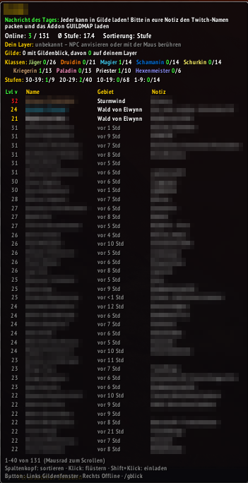
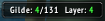

# Gildenblick

Eigenständiges Gilden-Addon für **World of Warcraft: Forever** (Interface 16001) – im Stil von Titan Panel Guild bzw. Socialite, aber ohne Abhängigkeiten.

## Installation

**Bitte nicht** den grünen Knopf „Code → Download ZIP“ benutzen – der erzeugt einen Ordner `Gildenblick-main`, den WoW nicht lädt.

### Manuell
1. Unter [Releases](../../releases/latest) die Datei `Gildenblick-x.y.z.zip` herunterladen.
2. Entpacken nach `World of Warcraft\_forever_\Interface\AddOns`  
   → es muss `...\AddOns\Gildenblick\Gildenblick.toc` entstehen.
3. Im Spiel `/reload`.

### Mit WowUp (automatische Updates)
„Install from URL“ → die URL dieses Repos einfügen. Falls WowUp den Forever-Client nicht selbst findet, den Ordner `_forever_` manuell hinzufügen.

### Addon taucht nicht auf?

1. **Ordner prüfen** – häufigster Fehler: Windows „Alle extrahieren“ legt einen Zusatzordner an.  
   Richtig: `...\_forever_\Interface\AddOns\Gildenblick\Gildenblick.toc`  
   Falsch: `...\AddOns\Gildenblick-1.1.1\Gildenblick\Gildenblick.toc` oder `...\AddOns\Gildenblick-main\...`
2. **Richtiger Client** – `_forever_`, nicht `_retail_` oder `_classic_era_`.
3. **Addon-Liste** – im Charakterauswahl-Bildschirm unter „AddOns“: Gildenblick muss angehakt sein.
4. **Im Spiel** – nach dem Einloggen erscheint im Chat „Gildenblick … geladen“. Der Button sitzt oben in der Bildschirmmitte. Nicht zu sehen? `/gblick reset` setzt Position und Einstellungen zurück.

## Funktionen

- Button mit **Online / Gesamt** (verschiebbar), Eintrag im Addon-Menü an der Minimap
- Optional als LibDataBroker-Quelle in **ElvUI-Datatexts**, Titan Panel, ChocolateBar
- Tooltip mit Nachricht des Tages, Ø-Stufe, Klassen- und Stufenverteilung
- Mitgliederliste: Stufe, Name in Klassenfarbe, AFK/DND, Gebiet, Notiz, Offiziersnotiz (mit Berechtigung), optional Rang
- **Layer-Anzeige**: eigene Layer-ID und die der Gildenmitglieder, die Gildenblick ebenfalls nutzen (grün = dein Layer)

## Bedienung

| Aktion | Wirkung |
|---|---|
| Maus über Button | Tooltip öffnen |
| Linksklick Button | Gildenfenster |
| Rechtsklick Button | Offline-Mitglieder ein/aus |
| Klick auf Spaltenkopf | sortieren, erneut = umgekehrt |
| Klick auf Mitglied | flüstern |
| Shift+Klick auf Mitglied | einladen (z. B. zum Layer-Wechsel) |
| Mausrad im Tooltip | scrollen |

## Befehle (`/gblick` oder `/gildenblick`)

| Befehl | |
|---|---|
| `lock` / `unlock` | Button sperren/entsperren |
| `button` | Button ein/aus |
| `sort rank\|name\|level\|class\|zone\|layer` | Sortierung |
| `offline` | Offline-Mitglieder |
| `rank` | Rang-Spalte |
| `notes` / `onotes` | Notizen / Offiziersnotizen |
| `summary` | Klassen-/Stufenübersicht |
| `layer` | Layer-Anzeige und -Austausch |
| `rows <10-200>` | Zeilen pro Seite |
| `scale <0.5-2>` | Tooltip-Skalierung |
| `reset` | Einstellungen zurücksetzen |

## Zur Layer-Anzeige

- Forever liefert keine offizielle Layer-Nummer. Die angezeigte ID stammt aus der GUID von NPCs in der Nähe (anvisieren, mit der Maus drüberfahren, Namensplaketten).
- Eine neue ID gilt erst, wenn zwei verschiedene NPCs sie bestätigen. Nach Ladebildschirm/Gebietswechsel steht sie auf „?“, bis sie neu gelesen wurde.
- Im Kampf und in Instanzen wird nichts gelesen.
- IDs aus verschiedenen Gebieten sind nicht vergleichbar und werden grau dargestellt.

## Neue Version veröffentlichen

1. In `Gildenblick/Gildenblick.toc` die Zeile `## Version:` erhöhen (z. B. `1.2.0`).
2. In `CHANGELOG.md` einen Abschnitt `## 1.2.0` ergänzen.
3. Auf `main` pushen. Die GitHub Action baut `Gildenblick-1.2.0.zip`, legt den Tag `v1.2.0` an und veröffentlicht den Release mit dem Changelog-Abschnitt als Text.

Pushes ohne neue Versionsnummer erzeugen keinen Release. Manuell auslösen geht unter *Actions → Release → Run workflow*.

## Hinweise

Entwickelt mit Unterstützung von Claude (KI). Fehler und Wünsche gerne als [Issue](../../issues).

Lizenz: [MIT](LICENSE)
